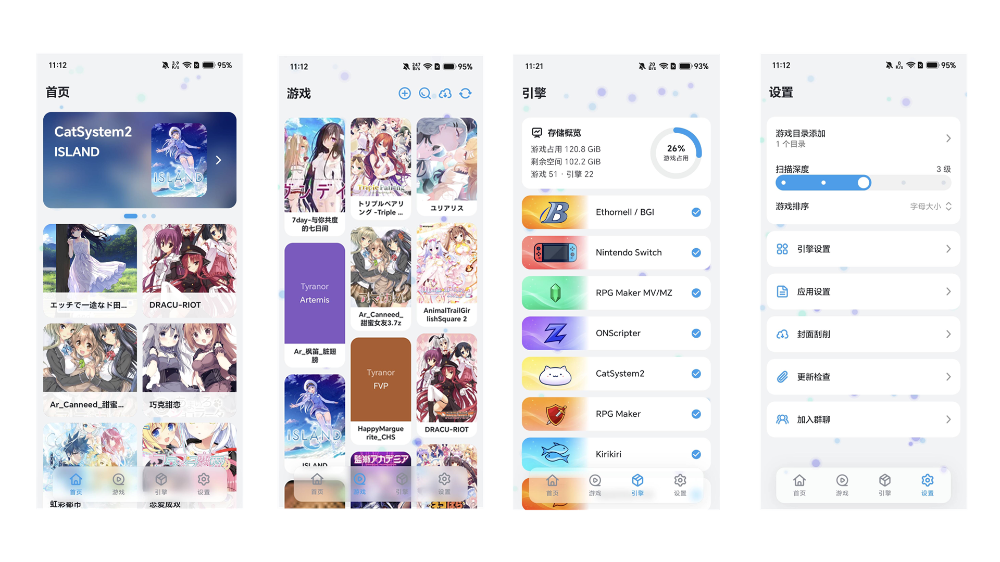
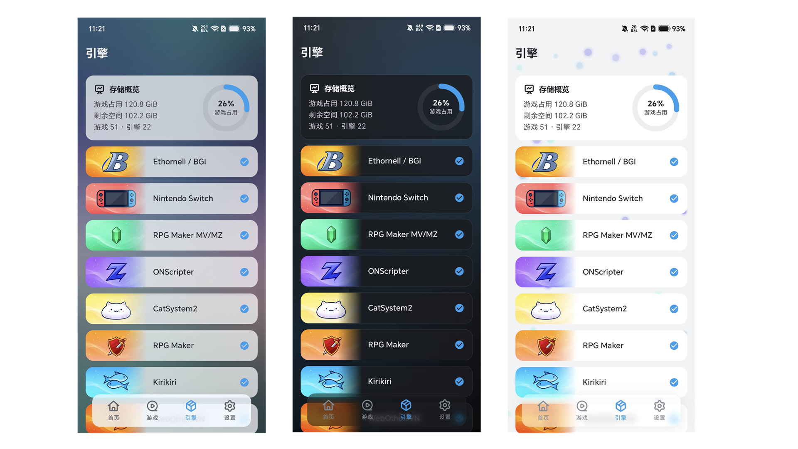
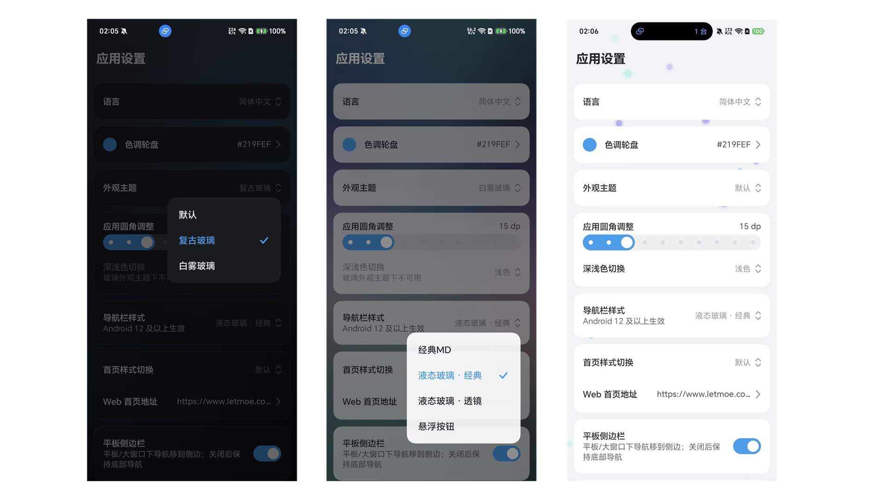
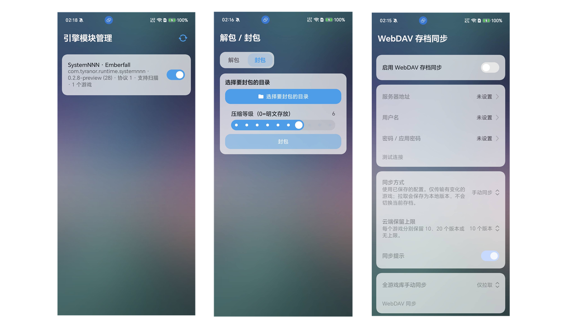
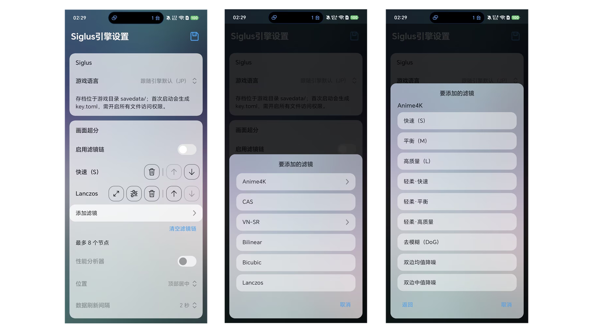

<p align="center">
  
</p>

基于 **Tyranor 模拟器逆向重写** 的多引擎视觉小说（Galgame）模拟器，面向 Android 平台。具体功能与兼容边界见 [SPEC.md](SPEC.md)。

iOS版本计划中...  鸿蒙设备可使用卓易通安装
主打轻便、简单、快捷，不引入其他冗余功能的简约设计思路

企鹅群：364439133   感谢 [@安音](https://www.pixiv.net/users/8182248) 为本项目绘画的logo娘！

默认主题界面（浅色）
<p align="center">
  
</p>

三种不同风格主题（不包含深浅色模式对比）
<p align="center">
  
</p>

多种个性化设置（部分展示）
<p align="center">
  
</p>

更多拓展功能（部分展示，第三方插件支持见 [docs/第三方APK运行时模块接入指南.md](docs/第三方APK运行时模块接入指南.md)）
<p align="center">
  
</p>

画面超分（展示配置）
<p align="center">
  
</p>

## 感谢各位贡献者们！一起成为光吧！

<a href="https://github.com/Weiss-UltimateSavior/Tyranor-Next/graphs/contributors">
  
</a>

## 支持范围

### 引擎与游戏类型

| 游戏类型                 | 典型识别特征                                                              | 运行环境                         |
| -------------------- | ------------------------------------------------------------------- | ---------------------------- |
| Kirikiri / Kirikiri2 | `.xp3`、`startup.tjs`                                                | Kirikiroid2 / krkrsdl3 原生运行时 |
| ONScripter           | `nscript.dat`、`.nsa`                                                | ONScripter 原生运行时             |
| Artemis              | `system.ini`、`.pfs`                                                 | Artemis 原生运行时                |
| SiglusEngine         | `Gameexe.dat`/`Gameexe.ini`、`Scene.pck`（根或 `Data/`）                | Siglus 原生运行时（siglus_rs）      |
| RealLive             | `Gameexe.ini` + `SEEN.TXT`（10000 项 TOC）或 `SEEN####.TXT`             | 内置视觉小说运行时（game_launcher）  |
| AVG32                | `Gameexe.ini` + `SEEN.TXT`（`PACL`）或 `SEEN###.TXT`（`TPC32`）          | 内置视觉小说运行时（game_launcher）  |
| UK2（PC-98）          | `UK2.CFG`、`*.MES`（`<< UK2 TEXT Ver1.00 >>` 头）                       | 内置视觉小说运行时（game_launcher）  |
| FVP                  | `*.hcb`/`*.bch` 脚本、`graph.bin`/`voice.bin` 等资源包                   | 内置 FVP 原生运行时（rfvp）          |
| CMVS                 | `data/pack/script.cpz` + `start.ps3/ps2`（仅 19 部登记作品）              | 内置 CMVS 原生运行时（cmvs-rs，NativeActivity） |
| System35             | `*.ALD`（`SA.ALD` 等；根目录或 `GAMEDATA/`）、`System39.ain`/`System39.ini`/`*.wai`/`*.bgi`/`*.alk` | 内置 System3.x 运行时（xsystem35） |
| System4              | `System40.ini` 或 `AliceStart.ini`（根目录；`*.ain` 为辅助特征）                    | 内置 System4 运行时（xsystem4）      |
| SystemNNN            | 游戏目录下的 `spt/sys.spt`（不区分大小写）                            | 内置 [SystemNNN-Emberfall 0.8.1](https://github.com/PorisRora/SystemNNN-Emberfall)（ARM64） |
| Ethornell / BGI      | 根目录的 `system.arc`（带 BGI 引导标记，且不与 UK2 冲突）             | 内置 Ethornell / BGI 运行时（`libethornell.so`） |
| YU-RIS               | `yscfg.dat`、`pac/*.ypf`、`YS*.DLL`、`.ymv`                          | 外置 Winlator（winlator-cn）        |
| CatSystem2           | `config/startup.xml`、`*.int`、`*.cst`、`*.hg3`、`*.kcs` 等组合         | 外置 Winlator（winlator-cn）        |
| PC（手动添加）        | 游戏页顶栏「添加 PC 游戏」选择目录并指定启动 exe                          | 外置 Winlator（winlator-cn）        |
| TyranoBuilder        | `index.html`、`tyrano/`                                              | 内置 Tyrano Web 运行环境           |
| RPG Maker XP         | `.rgssad`、`Game.ini` + `Data/*.rxdata`                              | 外置 RPGM APK 模块               |
| RPG Maker VX         | `.rgss2a`、`Game.ini` + `Data/*.rvdata`                              | 外置 RPGM APK 模块               |
| RPG Maker VX Ace     | `.rgss3a`、`Game.ini` + `Data/*.rvdata2`                             | 外置 RPGM APK 模块               |
| mkxp-z               | 用户选择/内部别名 `internal.mkxp-z`                                         | 外置 RPGM APK 模块               |
| RPG Maker MV         | `www/`、`js/rpg_core.js`                                             | 内置 Web 运行环境（Tyranor-2.3.4 / TynMV-0.1 / TynMV-0.2） |
| RPG Maker MZ         | `www/`、`js/rmmz_core.js`                                            | 内置 Web 运行环境（Tyranor-2.3.4 / TynMV-0.2） |
| VN                   | `globalData.vndata`                                                 | 内置 Web 运行环境                  |
| WebOther             | 通用 `index.html` 网页游戏                                                | 内置 Web 运行环境                  |
| Ren'Py               | `.rpa`、`game/script.rpy`、`game/options.rpy`、`renpy/` + `.rpy/.rpyc` | 外置 RenPy APK 模块（8.5.0 / 8.5.3 / 7.7.1；8.5.0 与 8.5.3 同包名，按所选版本下载安装） |
| Ruffle / Flash       | 顶层 `.swf`；根 `index.html/index.htm` + 唯一 SWF 的叶子目录                   | 外置 Ruffle APK 模块              |
| MAGES.（impacto）    | 按精确大小写的根目录条目识别上游 profile（如 `mo6tw` 的 `SYSTEM.CPK`、`SCRIPT.cls` 等） | 外置 Impacto 宿主 APK（引擎页点击跳转下载） |
| PSP                  | `.pbp`、`.cso`、`.iso`、`.chd`                                         | 外置 PPSSPP 模拟器                 |
| Nintendo Switch      | `.nsp`、`.xci`、`.nca`、`.nro`                                         | 外置 Eden 模拟器                   |

### 平台与文件要求

- Android 8.0（API 26）及以上。
- 当前原生引擎库仅提供 `arm64-v8a`，设备需为 64 位 ARM 架构。
- 游戏目录需位于 Android 可访问的本地存储，并通过系统文件选择器（SAF）授权；启动时目录必须能够映射为真实文件路径，外置存储上的部分引擎可能需要“所有文件访问”权限。
- 实际兼容性取决于游戏使用的引擎版本、封包/加密方式和脚本特性；特殊修改版可能需要调整引擎设置或补丁。

### 翻译工作台（持续实现中）

添加项目改用 TYN 底部抽屉：操作和引擎通过下拉项选择，来源整行显示目录或文件路径并打开 SAF 选择器；底部仅保留添加按钮，点击遮罩或系统返回关闭；文件自动识别为 MTool JSON，不提供 CSV 或格式选择。

工具页提供翻译工作台；项目列表按“全部项目 / 进行中 / 已完成”筛选并显示项目数；进行中包含尚未完成翻译或校对的项目，只有译文齐全且完成校对轮次的项目才归入已完成；即使没有项目，分类栏仍显示且各项计数为 0。添加项目使用 TYN 底部抽屉选择提取、翻译或校对；提取选择游戏目录，翻译与校对导入 MTool JSON 项目文件，校对由人工完成；来源行整行显示当前目录或文件路径并打开 SAF 选择器，未选择时显示提示；操作小字说明对应操作用途，引擎小字说明引擎选项用途；仅提取时可选引擎，导入项目时不需要选择引擎；抽屉底部仅有添加按钮，点击遮罩或系统返回关闭。项目文件自动识别为 MTool JSON。可创建 RPG Maker MV/MZ、2000/2003、RGSS（XP/VX/VX Ace/mkxp-z）游戏目录项目，也可导入 MTool JSON 原文/译文映射。当前支持授权目录只读提取、配置页提供 13 个机器翻译模板入口，默认启用的必应、Google 网页翻译和有道网页排在列表前面；AI 服务包含 OpenAI Chat Completions、OpenAI Responses API、Gemini Interactions 与 Anthropic Claude Messages，并支持 AI 翻译与可恢复的逐批进度；批量翻译通过分层卡片下拉选择服务、术语表与语言，原文可自动检测；支持可跨项目复用的命名术语表（新建后进入完整术语列表页管理多条术语，术语卡片分行标识原文、译文和备注，右侧编辑/删除使用纵向排列的独立按钮，备注标签始终显示且区域高度固定；术语表删除和术语删除使用上下排列的确认弹窗；单条术语保存后立即写入，返回时名称变更自动保存且不再弹出确认；开始翻译时下拉选择）、本地规则检查、人工编辑/确认与问题忽略、MTool JSON 项目文件导入/导出。AI 服务档案的高级设置使用独立完整页面，可编辑翻译系统与用户提示词、结构化输出；AI 翻译高级设置还提供默认关闭的回显对齐校验，要求逐条返回原文并检查条目对应关系；不再提供独立 Token 上限卡片，需要时可在自定义请求体添加相应协议字段。Temperature、Top P、Frequency/Presence penalty 等模型参数通过自定义请求体配置，支持按类型编辑请求头/请求体并加密保存；Gemini `generation_config` 可作为对象配置。所有 AI 服务配置均显示统一的思考等级（跟随默认、关闭思考、极低、低、中、高、超高、最高），各协议使用对应的请求参数；实际支持范围取决于服务商和模型。AI 服务页提供 OpenAI、DeepSeek、Gemini 与 Claude 四个内置模板，并保留“添加自定义 API”入口；内置模板和自定义 API 均可选 Chat Completions、OpenAI Responses、Anthropic Messages 与 Gemini Interactions 四种协议；内置模板预填名称和地址，但名称、协议与地址都可编辑，卡片显示当前地址并在编辑后保留原卡片关联；已保存的其它服务档案仍显示在列表中以便管理，内置模板配置页不提供删除档案操作。用户填写 API Key 与模型 ID。模型 ID 可获取或手动填写；AI 配置页将 API 协议单独分组，并把访问凭据放入“连接与模型”卡片；模型列表由“获取模型”单独请求，成功后在弹窗中筛选并选择；“测试连接”要求先填写模型 ID，再发送一条短文本验证翻译请求，空模型返回 MODEL_REQUIRED 且不请求网络。状态随文案自适应、最多两行，HTTP 错误会附带状态码。机器翻译也提供单条短文本测试。校对由人工完成；进入工作区时自动运行本地规则，用户可筛选条目、编辑译文、确认结果并处理问题。旧版 AI 校对任务、建议、AI 来源问题和专属提示词会在数据库升级时清除，项目译文、人工确认记录与本地规则问题保留。校对列表显示序号、原文、当前译文和确认状态；手机从列表进入详情，平板并排显示列表与详情。翻译任务固定启动时的服务配置、语言、系统/用户提示词、结构化输出、回显对齐开关与推理选项、类别化任务执行设置和术语表快照；AI 服务、DeepL 与 Yandex 接收术语表（Yandex 最多 50 对），其余 15 种机器翻译当前不接收。经校验的部分结果会独立落盘，取消或失败后可重试未完成项。提取覆盖约定的 MV/MZ JSON、2000/2003 LCF，以及 RGSS Marshal 和受限的 `.rgssad`/`.rgss2a`/`.rgss3a` 内存解密读取；脚本、插件自定义文本和非白名单资源不会解析。必应使用易变的网页翻译接口；Google 网页优先使用 Chrome 多条通道（单次最多 50 条、默认每批 30 条），失败时按限速回退 gtx 单条请求；有道网页默认将每批最多 30 条合并为一个换行请求，响应错位时逐条回退；必应网页为单条接口，复用限时会话并按默认 200 ms 间隔串行请求；四种 AI 协议均使用各自 adapter，可配置协议兼容服务地址；Gemini Interactions 默认地址为 Gemini Developer API，并使用 Gemini 专用的模型目录与交互路径。适配器仍按所选协议构造请求，填写自定义地址不代表兼容任意服务；Vertex AI 所需的独立 endpoint、认证与 project/location 配置尚未接入；其它服务需兼容 Gemini Interactions 的请求路径与响应格式。当前代码没有应用内运行时译表加载与交付通路，因此 MTool 文件导出不代表可在 TYN 中自动加载或已通过真实游戏显示验收。目前仅在 Medium Phone API 36 模拟器对必应、Google 网页翻译和有道网页翻译执行短文本探测及默认任务冒烟：必应逐条处理 30 条，Google 与有道各处理 60 条（默认批次 30、并发 2），全部通过；Google/有道批量请求另有协议级回归覆盖。其它服务账号、语言/网络地区稳定性、翻译质量、真实游戏样本与手机/平板 UI 验收尚未完成；旧代际格式与限制见[提取范围说明](docs/翻译工作台首期实现说明.md)。

翻译服务列表和术语表列表在手机上单列显示，在平板上每行显示两张卡片；服务分类切换、分类标题、说明和错误提示横跨整行。

翻译服务的机器翻译/AI 分类内容、服务配置、任务设置、高级设置和自定义参数页，以及翻译工作台筛选后的项目卡片内容，都通过共享分页动效水平切换；普通档复用已有的标准内容转场。自定义请求头/请求体内容也使用同一转场。引擎分类普通档继续保持即时切换。

翻译服务 AI 分类的“添加自定义 API”、术语表列表的“添加术语表”与术语详情的“添加术语”使用 Miuix Scaffold 浮动加号按钮，不占据固定列表行或底部操作行。术语表管理与术语详情在手机单列、平板双列显示卡片，名称输入与列表标题横跨整行。机器翻译内置服务名称固定；配置修改后按返回自动保存，任务设置页面仍保留保存和取消。

翻译项目卡片按提取、翻译、校对三个阶段展示当前状态与持久化进度条，并提供当前阶段操作、导出和删除。失败提示替代进度条上方的普通状态文案，不额外增加卡片高度；删除确认使用 Miuix OverlayDialog，删除按钮在上，取消按钮在下。导出按钮仅在有条目且没有进行中的任务时启用；刚添加但尚未提取的游戏项目置灰，已导入且含条目的项目可直接导出。导出格式通过弹窗下拉项选择（当前仅提供 MTool JSON）；保存位置使用整行文件夹入口打开 SAF 选择器。

工作台手机内容最大宽度为 760dp，平板最大宽度为 1440dp 并居中显示；添加项目和术语表入口并排，项目卡片列表在手机单列、平板双列展示，并按列宽显示阶段、进度与操作。

翻译工作台（包括任务设置和校对编辑）与翻译服务的文本输入统一使用 Miuix TextField。

每个翻译服务可单独配置任务执行参数。机器翻译设置批次大小、批次并发、请求间隔和每分钟请求数；AI 设置批次大小、批次并发和请求间隔；两类服务均可设置请求超时（5–600 秒，默认 120 秒），并且超时会作用于实际网络请求。默认 AI 每批 20 条、并发 1、间隔 0 秒。任务开始时固定设置快照；AI 按条目数量拆批，不进行 Token 估算拆批。AI 高级设置可按协议选择结构化输出，并提供默认关闭的回显对齐校验；不再显示独立 Token 上限卡片，需要时可通过自定义请求体配置对应字段；自定义请求头/请求体参数页手机单列、平板双列，使用右下角加号新增并通过弹窗编辑，参数加密保存；Temperature、Top P 等模型参数通过自定义请求体填写，所有 AI 服务配置均显示统一的思考等级（跟随默认、关闭思考、极低、低、中、高、超高、最高），各协议使用对应的请求参数；实际支持范围取决于服务商和模型。任务固定启动时的参数引用，不把参数值写入 Room 快照。

翻译服务的连接测试使用独立的 15 秒上限，不受任务请求超时设置影响；测试中的状态只显示在当前服务编辑页，切换服务或退出页面会取消该次测试。Chat Completions 在关闭结构化输出时，单条连接探测也接受校验通过的纯译文；正式批量翻译仍要求带稳定条目 ID 的 JSON 结果。

AI 模型列表获取同样使用不超过 15 秒的交互式上限，并沿用较短的服务请求超时；超时会显示 `TIMEOUT`，同时取消底层 HTTP 请求。四种 AI 协议中，Chat Completions 的 API Key 可选，以支持无需鉴权的本地兼容服务；OpenAI Responses、Gemini Interactions 与 Anthropic Messages 要求 Key。必应、Google 网页和有道网页翻译使用网页协议，不要求用户密钥。

## 参与贡献

欢迎参与项目开发与维护！

在提交 Pull Request 前，请先阅读务必阅读遵守 [贡献指南](./CONTRIBUTING.md)。
如果不符合贡献指南的要求，可能会被拒绝合并。
代码务必符合项目整体风格，避免引入新的问题。
提交前请务必使用项目内AGENTS.md文件内的审核方式进行提交前审核。
如果代码一眼丁真，一定拒绝合并。

## 技术架构

开发与维护文档：[仓库规范](AGENTS.md) · [架构说明](ARCHITECTURE.md) · [功能规格与验收清单](SPEC.md) · [领域术语](CONTEXT.md) · [变更记录](CHANGELOG.md)。专题方案与 `.archify/` 图表保留其生成时的上下文；当前实现以源码及上述架构/规格说明为准。


## 可视化文档

`.archify/` 下随仓库提供一组基于当前代码生成、经自动化校验（schema 校验 + 真实浏览器渲染检查）的交互式图表：均为自包含 HTML，浏览器直接打开即可缩放、检索/聚焦节点、切换深浅主题并导出图片；每个目录内同时保留可编辑的 `candidate.json` 源数据与校验回执，可配合 archify skill 重新渲染。

| 图表 | 类型 | 覆盖内容 |
| --- | --- | --- |
| [系统总览](.archify/架构图-系统总览-20261006-022735/architecture-overview.html) | 架构图 | 三层架构、主进程 / 引擎进程族边界、外置模块与模拟器、在线服务集成 |
| [引擎运行时与原生插件体系](.archify/架构图-引擎运行时-20261006-022735/architecture-engine-runtime.html) | 架构图 | 插件供给链、宿主与 JNI 桥接、预编译运行库、Rust XP3 与 Web 壳 |
| [应用功能地图](.archify/功能图-应用功能地图-20261006-022735/architecture-feature-map.html) | 功能图 | 六大功能域 × 18 项能力及对应实现组件 |
| [游戏扫描与入库流程](.archify/流程图-游戏扫描入库-20261006-022735/workflow-scan-import.html) | 流程图 | SAF 授权、目录遍历、引擎识别优先链、差量合并与 Room 落库 |
| [游戏启动编排流程](.archify/流程图-游戏启动编排-20261006-022735/workflow-launch-orchestration.html) | 流程图 | 四级分流（安卓 / 模拟器 / 外置模块 / 内置引擎）与启动前确认 |
| [KiriKiri 启动请求时序](.archify/时序图-KiriKiri启动-20261006-022735/sequence-kirikiri-launch.html) | 时序图 | 插件保障 → SAF 镜像 → Intent → JNI 桥接 → TVP 就绪全链路 |
| [游戏库数据与封面管线](.archify/数据流图-游戏库与封面-20261006-022735/dataflow-library-covers.html) | 数据流图 | 采集、识别、Room 权威存储、prefs 镜像、封面缓存与消费方 |
| [RPG Maker MV/MZ 存档生命周期](.archify/生命周期图-存档互通-20261006-022735/lifecycle-save-interop.html) | 生命周期图 | 互通同步、格式转化、延迟回前台与中止等状态 |

## 构建

```bash
# 编译 Debug APK
./gradlew assembleDebug --no-daemon
```

产物位于 `app/build/outputs/apk/debug/`。需要 Android SDK（本地平台 `android-37.0`）环境。

CI 使用 JDK 17；还需 engine 的 Android 36 平台、Build Tools 37.0.0、NDK 28.0.13004108 与 CMake 3.22.1。Windows 使用 `./gradlew.bat`。JVM 回归运行 `./gradlew testDebugUnitTest --no-daemon`，完整检查命令与设备验收边界见 [AGENTS.md](AGENTS.md#构建)。普通 Gradle 构建使用已提交的运行库，不自动重编所有原生引擎。

## 目录结构

```
app/
├── src/main/java/com/tyranor/next/
│   ├── core/      功能抽象层：扫描、启动、引擎模块、封面、游玩状态、存档、补丁、拆封包、配置、授权、网络（各域共享 HTTP 层）、更新
│   ├── ui/        界面 UI 交互层：主界面、游戏页、设置页、弹窗、公共组件
│   └── theme/     Compose / Miuix 主题、色调、深浅色适配
├── src/main/assets/rtp/    App 自有 RTP 资源
├── src/main/nativeplugins/ 插件 manifest 与 app-only 插件源头
├── build/generated/assets/ 构建生成的 engine/ 共享脚本与 nativeplugins/ 插件资产（.zip.xz）
├── schemas/                Room schema（随代码提交）
└── src/{test,androidTest,releaseProbe}/ JVM、设备与 release probe 测试

engine/
├── src/main/java/          底层引擎宿主、桥接代码与运行时入口
├── src/main/cpp/           本地编译的 Native/JNI 与图形桥
├── src/main/assets/        底层引擎资源与共享引擎脚本源头
├── src/main/nativeplugins/ 共享 Native 插件 so 源头
├── src/main/jniLibs/       预编译原生运行库（arm64-v8a）
├── src/test/              JVM 回归与 Node Web 桥 harness
└── rust/                   XP3 解封包 Rust 源码（xp3 解析与 KSD mode-2 隐性解码；许可证见 LICENSE.usefulunpack）

buildSrc/、tools/、.github/workflows/  构建校验、工具与 CI
docs/、.archify/                     专题方案、审查记录与可视化
```

## 许可证

本项目基于 **GNU General Public License v2.0** 发布（GPL-2.0-only），详见 [LICENSE](LICENSE)。

`engine/` 引擎运行时基于 Tyranor 模拟器逆向重写，上游涉及 Kirikiroid2 / ONScripter 等 GPL-2.0 项目，因此整个项目以 GPL-2.0 分发；衍生作品须遵循 GPL-2.0 条款，并随发行物提供完整源码。Miuix 等第三方依赖按各自许可证引入；代码/资产级第三方声明汇总见 [THIRD_PARTY_NOTICES.md](THIRD_PARTY_NOTICES.md)。

| 运行库 | 上游 | 许可证 | 溯源与许可文本 |
| --- | --- | --- | --- |
| Siglus / RealLive / AVG32 / UK2 | [siglus_rs](https://github.com/xmoezzz/siglus_rs) | MPL-2.0 | 上游仓库 |
| FVP | [rfvp](https://github.com/xmoezzz/rfvp) | MPL-2.0 | 上游仓库 |
| CMVS | [cmvs-rs](https://github.com/Weiss-UltimateSavior/cmvs-rs) | MIT OR Apache-2.0 | `tools/cmvs/` |
| SystemNNN | [SystemNNN-Emberfall](https://github.com/PorisRora/SystemNNN-Emberfall)（原版 SystemNNN 由 tinyan 开发） | GPL-2.0-only | [对应源码及构建记录](engine/src/main/assets/licenses/systemnnn/ffmpeg-source.txt)、[归属与许可](engine/src/main/assets/licenses/systemnnn/upstream-source.txt) |
| System35 | [xsystem35-sdl2](https://github.com/kichikuou/xsystem35-sdl2) | GPL-2.0-or-later | `engine/xsystem35/BUILD.md`、`engine/xsystem35/licenses/` |
| System4 | [xsystem4](https://github.com/nunuhara/xsystem4) / [libsys4](https://github.com/nunuhara/libsys4) | GPL-2.0-or-later | `engine/xsystem4/BUILD.md`、`engine/xsystem4/licenses/` |
| Anime4K 着色器 | [bloc97/Anime4K](https://github.com/bloc97/Anime4K) | MIT | `engine/src/main/assets/anime4k/` |
| VN-SR C08 / C12 / C16 | [AAAA1111-Lab/VN-SR](https://github.com/AAAA1111-Lab/VN-SR) | MIT | [VN-SR滤镜集](docs/vnsr-filters.md) |

System35 / System4 的源码取自对应 fork（固定 commit），构建剧本、补丁记录与静态依赖（SDL2、freetype、libwebp、libsndfile 等）的完整许可证文本见上述 BUILD.md 与 `licenses/` 目录。

System4 运行时包含 libjpeg-turbo；依 IJG 许可要求，随分发文档声明：**This software is based in part on the work of the Independent JPEG Group.**（原文见 `engine/xsystem4/licenses/README.ijg`，许可说明见 `engine/xsystem4/licenses/libjpeg-turbo-LICENSE.md`）

## 致谢
- [Kirikiroid2](https://github.com/zeas2/Kirikiroid2): Kirikiroid2引擎
- **Tyranor 模拟器**：本项目引擎运行时与核心架构的逆向重写基础
- [Artemis-Compat](https://github.com/Weiss-UltimateSavior/artemis-compat)：自研兼容内核
- [siglus_rs](https://github.com/xmoezzz/siglus_rs)（MPL-2.0）：SiglusEngine / RealLive / AVG32 / UK2 的 Rust 重写与多平台移植，四个引擎的运行时
- [rfvp](https://github.com/xmoezzz/rfvp)（MPL-2.0）：FVP 引擎的 Rust 重写与多平台移植，FVP 运行时
- [xsystem35-sdl2](https://github.com/kichikuou/xsystem35-sdl2)（GPL-2.0-or-later）：AliceSoft System 3.x 引擎的开源重实现（SDL2 移植），System35 运行时；依赖 [SDL2](https://github.com/libsdl-org/SDL) / [SDL2_mixer](https://github.com/libsdl-org/SDL_mixer)（zlib）、[freetype](https://freetype.org/)（FTL/GPLv2）、[libwebp](https://chromium.googlesource.com/webm/libwebp)（BSD-3-Clause）
- [xsystem4](https://github.com/nunuhara/xsystem4) 与 [libsys4](https://github.com/nunuhara/libsys4)（GPL-2.0-or-later）：AliceSoft System 4 引擎的开源重实现及其底层库，System4 运行时；Android 构建参考 [xsystem4-android](https://github.com/kichikuou/xsystem4-android)（kichikuou），仅作事实参考。依赖 [libsndfile](https://github.com/kichikuou/libsndfile)（LGPL-2.1-or-later，`xsystem4` 分支）等，见「许可证」
- **RinneMobile**：游戏扫描识别/SAF路径映射逻辑/独立存档映射/krkrsdl3 等多个功能的参考与实现
- [Miuix](https://github.com/compose-miuix-ui/miuix)：设置界面组件库
- [Anime4K](https://github.com/bloc97/Anime4K):（bloc97，MIT）：KRKR 游戏画面实时超分（线条重建 CNN 着色器）
- [OnscripterYuri](https://github.com/YuriSizuku/OnscripterYuri): ONS引擎
- [UsefulUnpack](https://github.com/znso4pa/usefulunpack)（znso4pa，MIT）：XP3 / KSD 解封包 Rust 实现（`engine/rust` 的 `lib.rs` / `common.rs` / `ksd.rs` 来源，许可证见 `engine/rust/LICENSE.usefulunpack`）

校对入口直接进入人工校对；本地规则在进入工作区时自动检查。工作区筛选使用 Miuix 弹窗，平板并排显示条目表与译文详情，手机仍按列表进入详情。
